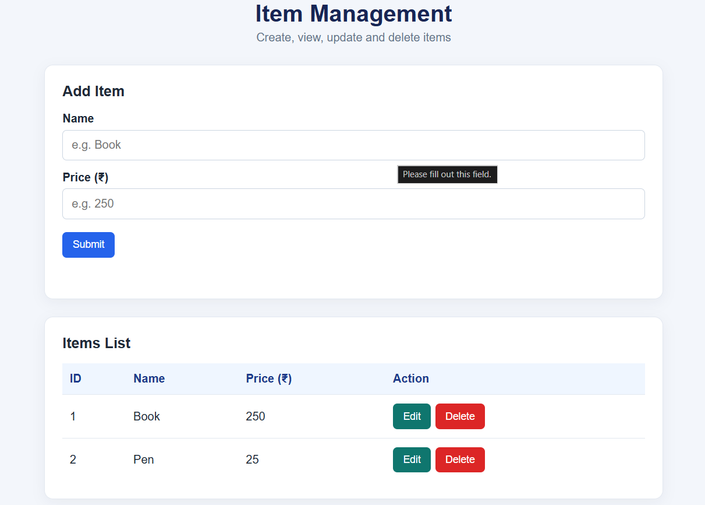
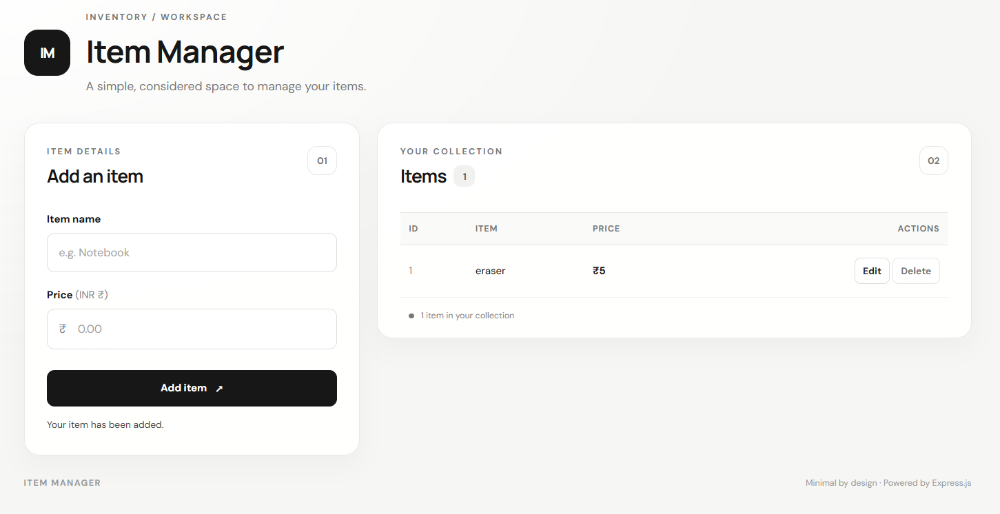
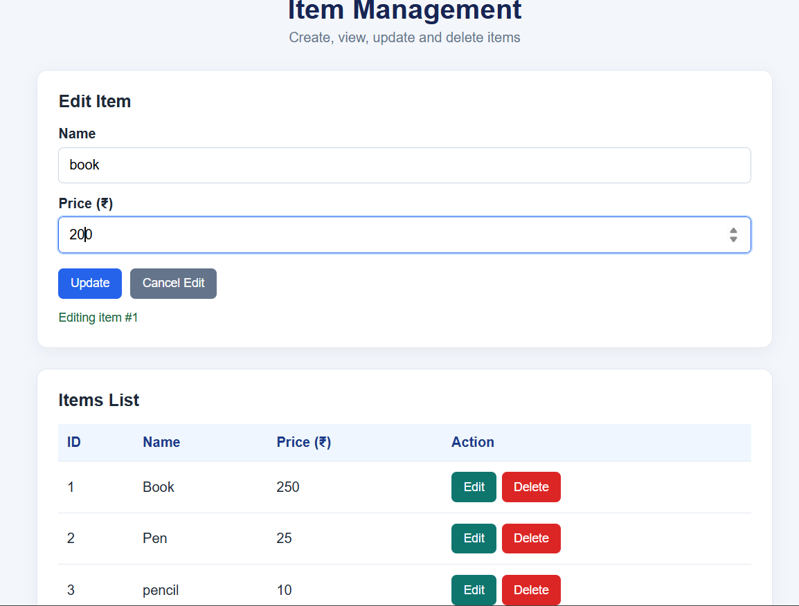
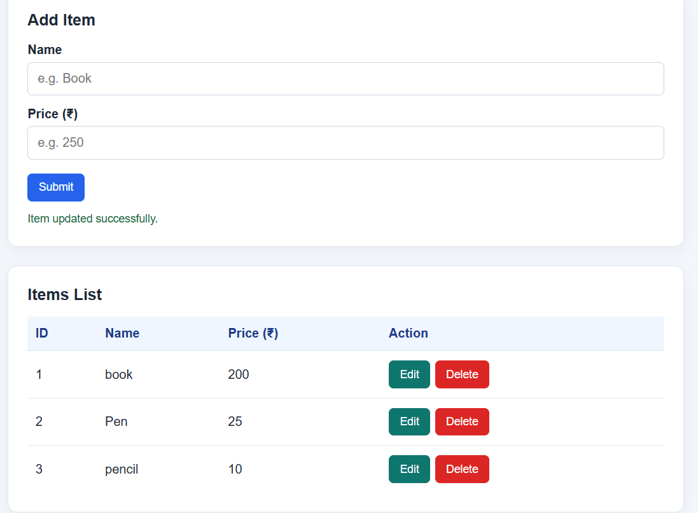
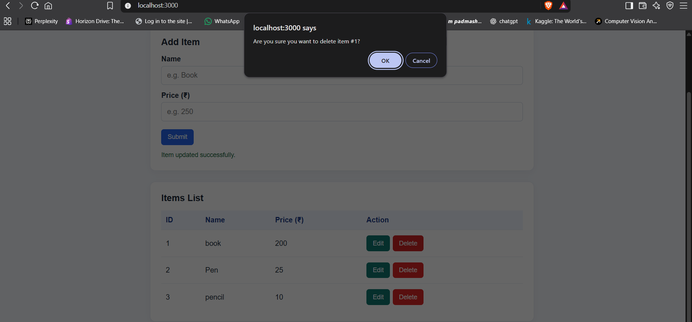
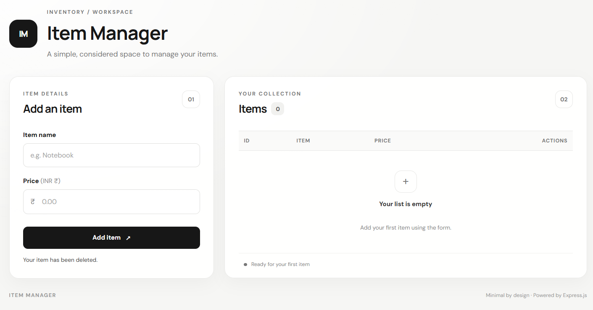

# Item CRUD Application

A simple CRUD application built using HTML, CSS, JavaScript, Node.js, Express.js, and REST API.

## Features

- Create new items with a name and price.
- View all items in a table.
- Edit existing items.
- Delete items with confirmation.
- REST API for managing items.
- Input validation.

## Tech Stack

- HTML
- CSS
- JavaScript
- Node.js
- Express.js
- REST API

## Application Output:
<b>1.Initial output:



2.Add-item Output:



3.Edit-item Output:



4.Update-item Output:



5.Delete-item Output:</b>





## Project Structure

```text
item-crud-express/
├── public/
│   ├── index.html
│   ├── style.css
│   └── app.js
├── package.json
└── server.js
```

## How to Run

1. Install Node.js.
2. Clone this repository:

   ```bash
   git clone https://github.com/1Akash-Acharya/item-crud-express.git
   ```

3. Open the project folder in the terminal.
4. Install dependencies:

   ```bash
   npm install
   ```

5. Start the application:

   ```bash
   npm start
   ```

6. Open `http://localhost:3000` in your browser.

## REST API Endpoints

| Method | Endpoint | Operation |
|---|---|---|
| GET | `/api/items` | View all items |
| GET | `/api/items/:id` | View one item |
| POST | `/api/items` | Add an item |
| PUT | `/api/items/:id` | Update an item |
| DELETE | `/api/items/:id` | Delete an item |

## Data Storage

Items are stored in an in-memory JavaScript array. Data resets when the server restarts.

## Learning Outcomes

- CRUD operations
- REST API fundamentals
- Express.js routing
- Frontend and backend communication
- JavaScript array manipulation
